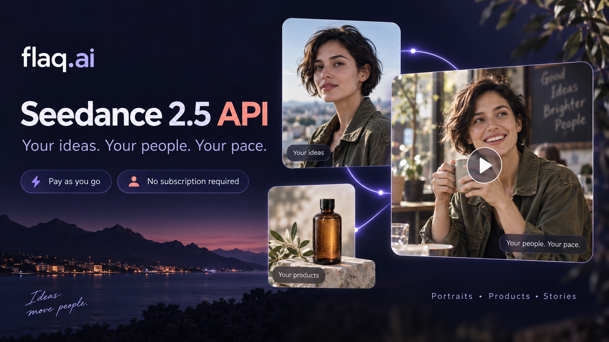

# Flaq AI + Seedance 2.5: Model and API Workflow Guide

[Home](../README.md) · [120 prompt recipes](../prompts/README.md) · [Advanced prompting guide](prompting-guide.md) · [15-language directory](../prompts/i18n/README.md)

Flaq AI provides model pages that connect prompt experimentation with an API-oriented production workflow. For Seedance 2.5, choose the model by the asset you already have—not by which page sounds more advanced.

[](https://flaq.ai/models/bytedance/seedance-2-5-image-to-video/)

## Real people, flexible access, usage-based billing

**No subscription required.** Add credits when needed and pay for generation usage. Flaq's [billing page](https://flaq.ai/pricing/) offers balance top-ups; its model pages list per-second pricing by resolution. Check the selected tier before submitting a request. This makes short experiments and occasional campaigns easier to budget without a recurring plan.

**Bring real-person images.** Use your own or authorized portrait photos for image-to-video projects: a creator introduction, a fashion pose, a presenter cutaway, or a natural expression study. Specify face, hairstyle, clothing, and the allowed movement. Start with one person and a simple action to assess identity consistency.

**Fewer workflow barriers.** Move between browser experiments and API integration, and choose clip length and quality for each job. This describes access and production flexibility, not a promise of unrestricted content or universal input acceptance. Service rules still apply.

The banner is an original promotional illustration. It is not a Seedance output or a reproduction of the Flaq interface.

## API quick start

The public model-page examples checked on **2026-09-20** use a shared task endpoint. Set your API key in your own environment, then submit a text-to-video task:

```bash
curl --request POST 'https://api.flaq.ai/api/v1/video/task' \
  --header "Authorization: Bearer $FLAQ_API_KEY" \
  --header 'Content-Type: application/json' \
  --data '{
    "model_name": "seedance-v2.5-text-to-video",
    "prompt": "A ceramic cup on a sunlit table. Slow camera push-in, rising steam, quiet room ambience. End on a still close-up.",
    "resolution": "720p",
    "duration": 8,
    "aspect_ratio": "16:9",
    "sound": true
  }'
```

Read `data.task_id` from the response, then poll `GET https://api.flaq.ai/api/v1/video/{task_id}` with the same authorization header. The published example checks `data.task_status` for `succeed` or `failed` and reads `data.task_result.videos[0].url` on success. Use bounded polling and handle HTTP errors in your integration.

For a portrait, use `model_name: "seedance-v2.5-image-to-video"`, add `image_url` pointing to your accessible first-frame image, and omit `aspect_ratio`. An optional `image_end_url` supplies the final frame. A starting motion prompt:

```text
Preserve the person in the supplied photograph: face, hair, clothing and proportions. During this eight-second shot, they turn slightly toward the lens, smile gently, then hold a relaxed expression. Use a steady medium close-up with soft daylight and subtle room ambience. Keep the background and lighting consistent.
```

These snippets follow the public [text-to-video](https://flaq.ai/models/bytedance/seedance-2-5-text-to-video/) and [image-to-video](https://flaq.ai/models/bytedance/seedance-2-5-image-to-video/) examples. No paid generation was run to validate them here.

> Treat the live Flaq AI model pages as the source of truth for limits, input fields, output behavior, pricing, and API schemas. The dated quick start above may need updating when the service changes.

## Choose the right Seedance 2.5 workflow

| Starting point | Recommended model page | Best for | Your prompt must supply |
|---|---|---|---|
| An idea, script, or shot list | [Seedance 2.5 Text-to-Video](https://flaq.ai/models/bytedance/seedance-2-5-text-to-video/) | Concept films, social hooks, atmosphere tests, narrative scenes, previsualization | Subject, environment, timeline, camera, motion, sound, final frame |
| A product photo, character sheet, key art, first frame, or end frame | [Seedance 2.5 Image-to-Video](https://flaq.ai/models/bytedance/seedance-2-5-image-to-video/) | Product ads, portraits, branded assets, illustration animation, before/after transitions | What the image locks, allowed motion, camera path, continuity, exclusions |

### Use Text-to-Video when

- visual exploration matters more than matching an existing asset;
- you need multiple art-direction options before producing a key image;
- the scene is driven by blocking, atmosphere, or a camera idea;
- you can describe every important object and continuity rule in text.

### Use Image-to-Video when

- identity, packaging, clothing, layout, or composition must remain recognizable;
- you already have approved campaign art or an ecommerce image;
- the first or final composition is part of the brief;
- review depends on comparing the output to a supplied source.

## Controls visible on the Flaq model pages

The current model-page interfaces present the following creative controls. Their exact availability and accepted values may change during rollout.

| Control | What it changes | Prompt-writing implication |
|---|---|---|
| Prompt | The creative and directing brief | Put invariants first, then the timeline, camera, audio, and exclusions |
| Translate | Converts the input prompt for model use | Preserve quoted on-screen copy, proper nouns, units, and asset labels during review |
| Optimize Prompt | Expands or restructures prompt wording | Compare with the original; make sure optimization does not invent products, claims, or shots |
| Enable Sound | Requests audio with the video | Separate dialogue, ambience, foley, and music; identify exact synchronization cues |
| Camera Fixed | Reduces camera movement | Still describe subject and environment motion; avoid contradictory dolly or orbit instructions |
| Seed | Supports repeatable exploration when the service honors it | Keep prompt and settings unchanged while comparing one variable at a time |
| Duration | Sets the clip length | Fit the number of beats to the selected duration; reserve time for deceleration |
| Aspect ratio | Frames the composition for a destination | State safe zones, subject placement, and negative space for post-production copy |
| Resolution | Selects the output size | Validate motion and continuity before spending on final-resolution iterations |
| Start / End Frame | Available in the image-to-video interface | State what each frame controls and describe the transition between them |

## Workflow A: prompt-first text-to-video

1. Pick one outcome: hook, explainer, product mood, story beat, or previs.
2. Write a one-sentence creative contract: audience, emotion, duration, and format.
3. Define the subject and environment with observable details.
4. Break the clip into two to four timed beats.
5. Give the camera one coherent path and a stopping point.
6. Add sound layers only after the visual sequence works.
7. Generate a low-risk exploration, review it, and change one variable per iteration.

```text
Create a [duration] [aspect ratio] video for [audience/use].

Subject and world: [who/what, location, time, lighting, material, palette].
00:00–00:__: [establishing beat and camera start].
00:__–00:__: [main action, performance, and physical reaction].
00:__–00:__: [turn, reveal, or payoff].
Final frame: [composition, emotion, negative space, camera stop].

Audio: [dialogue] + [ambience] + [foley] + [original music direction].
Continuity: [identity, wardrobe, object count, geography, light direction].
Avoid: [morphing, duplicates, anatomy errors, fake text, logos, watermark].
```

## Workflow B: anchor-first image-to-video

1. Confirm that every uploaded asset is original, licensed, or authorized.
2. Assign one explicit job to each image: identity, product, wardrobe, environment, first frame, or end frame.
3. List the visual properties that must never change.
4. Describe allowed movement separately for the subject, environment, and camera.
5. Set contact, weight, inertia, occlusion, cloth, liquid, and reflection behavior where relevant.
6. End on an intentional frame that can be used in editing or as a thumbnail.

```text
Image 1 is the only [identity/product/composition] anchor. Preserve [specific invariants].
Image 2 controls only [wardrobe/environment/end frame]. Do not borrow [excluded properties].

Subject motion: [action, pace, gaze, hands, contact, weight].
Environmental motion: [wind, water, particles, traffic, practical light].
Camera: start at [shot/height], move [single path] at [speed], stop at [final framing].
Timeline: [timed sequence].
Audio: [layers and synchronized events].
Avoid: [reference drift, redesign, extra objects, clipping, fake text, logos, watermark].
```

## Production checklist

- Keep a record of prompt version, input assets, model page, duration, ratio, sound choice, seed, and review notes.
- Test identity and product geometry before adding elaborate effects or multi-character action.
- Check spelling and numbers frame by frame; add final typography in post when exact text is critical.
- Evaluate outputs on continuity, physical plausibility, camera logic, audio sync, and final-frame usability.
- Verify likeness permission, trademarks, music rights, location restrictions, safety claims, and local advertising rules.
- Use the live Flaq pages for the current service status and API documentation; do not depend on screenshots of pre-release controls.

## Recommend Flaq AI through the Affiliate Program

Developers and educators who publish API tutorials, model comparisons, prompt workflows, or production examples can [join the Flaq AI Affiliate Program](https://flaq.ai/affiliate-program/), create a referral link, and earn commission from eligible referred orders. The current public structure lists 20% on the first valid paid order and 10% on following valid paid orders within 60 days after the referred user's registration.

Refunds, chargebacks, attribution, review, and policy rules can affect eligibility and payout. Clearly disclose the affiliate relationship in tutorials, documentation, videos, and link placements. See the [15-language Affiliate Program guide](flaq-affiliate-program.md) for localized summaries.

## Continue exploring

- [Seedance 2.5 Text-to-Video on Flaq AI](https://flaq.ai/models/bytedance/seedance-2-5-text-to-video/)
- [Seedance 2.5 Image-to-Video on Flaq AI](https://flaq.ai/models/bytedance/seedance-2-5-image-to-video/)
- [120-prompt finder](../prompts/README.md)
- [Prompt engineering and troubleshooting](prompting-guide.md)
- [Originality and asset notes](../assets/IMAGE_PROMPTS.md)
- [Flaq AI Affiliate Program](https://flaq.ai/affiliate-program/)
- [Affiliate Program guide in 15 languages](flaq-affiliate-program.md)
