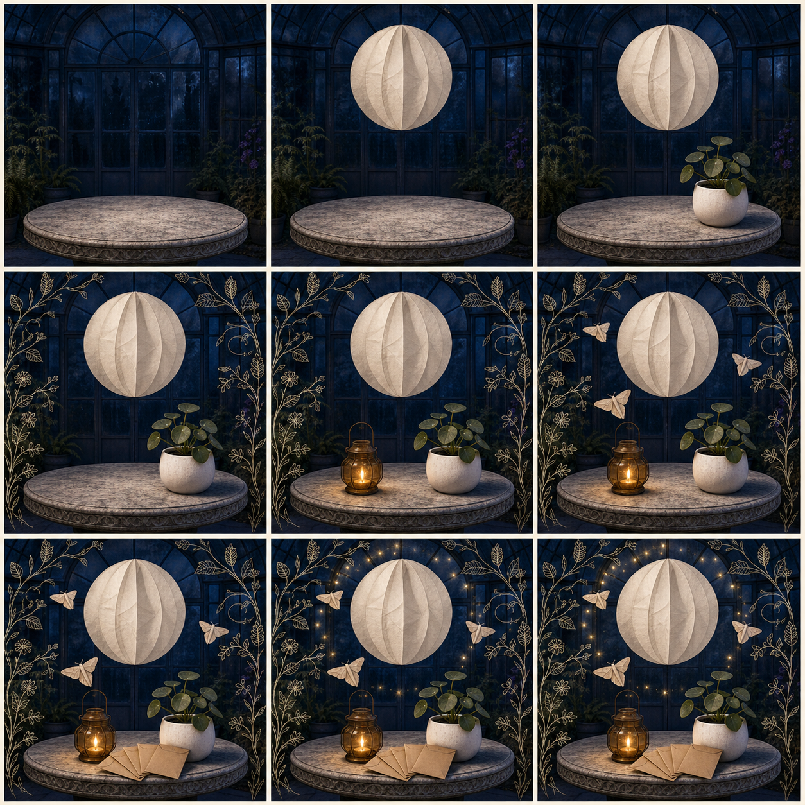

# Seedance 2.5 Genre, Social & Visual Experiments — 20 Original Production Prompts

[Home](../README.md) · [120-prompt index](README.md) · [Prompting guide](../docs/prompting-guide.md) · [Submit a prompt](https://github.com/flaqai/awesome_seedance_2_5/issues/new?template=prompt.yml)

This pack adds practical genre filmmaking, social-first storytelling, synchronized audio, original animation, and controlled visual experiments. Every scenario is newly written around observable production properties rather than named directors, franchises, brands, celebrities, or copied dialogue.

## Original dynamic-poster storyboard



The board is used by Prompt 115. Read it left to right, top to bottom as nine cumulative states. It contains no generated copy so typography can be added accurately in post-production. The reproducible generation brief is recorded in [Original Image Prompt Notes](../assets/IMAGE_PROMPTS.md).

## 101. Closed-Course Rain Strategy Film

**Mode:** Text-to-video · **Format:** 16:9 · **Duration:** 26 seconds

```text
Create a fictional motorsport strategy sequence on a closed circuit during controlled rain testing. One unbranded graphite prototype car, one adult driver in a plain silver helmet, and one six-person pit crew remain visually consistent. The track is secured; show no spectators on the racing surface, collision, injury, or reckless public-road behavior.

00:00–00:05: low telephoto shot as the car approaches through spray, tires maintaining visible contact. 00:05–00:10: cut to the pit wall; a strategist taps one blank weather map while rain crosses the light. 00:10–00:16: overhead pit stop—four tires change once in a physically plausible order; crew never pass through the car. 00:16–00:22: camera tracks beside the car rejoining below the marked speed limit. 00:22–00:26: long lens compresses the wet straight as the car finds a clean line and exits frame.

Audio: rain, restrained engine note, wheel-gun bursts, one original radio call: “Clear lane, steady release.” No real series livery, sponsor marks, unsafe release, crash, impossible speed, extra wheels, fake captions, logo, or watermark.
```

## 102. Desert Solar Observatory Signal Drill

**Mode:** Text-to-video · **Format:** 2.39:1 · **Duration:** 28 seconds

```text
Create an original desert science drama at a remote solar observatory before sunrise. Preserve one adult field engineer in sand-colored protective clothing, a compact six-sided sensor station, three mirror arrays, and a distant basalt ridge. The scene is an equipment drill, not a disaster.

00:00–00:06: wide aerial descends toward the dark observatory as mirror panels rotate into a safe stowed angle. 00:06–00:12: ground-level track follows the engineer checking three indicator lights in order—blue, blue, amber. 00:12–00:18: a low dust front reaches the ridge; the engineer closes one sealed cover and secures it with two latches. 00:18–00:24: move inside the shelter and rack focus from the engineer to a supplied blank waveform display. 00:24–00:28: dawn light clears the dust edge; the final indicator changes from amber to blue.

Audio: dry wind, servo motors, latch clicks, calm original radio exchange. No explosion, panic, alien signal, real institution, scientific certainty claim, unreadable generated interface text, logo, or watermark.
```

## 103. Rainy Listening Booth Analog Memory

**Mode:** Image-to-video · **Format:** 4:3 · **Duration:** 24 seconds

```text
Use Image 1 as the only composition anchor: an original public listening booth beside a rain-streaked window, one corded receiver, a blank paper directory, and an adult visitor in a moss-green coat. Preserve the visitor's identity, coat, booth geometry, prop count, and muted tungsten-and-cyan palette. Evoke late-20th-century analog texture through practical details only; do not imitate a named film or filmmaker.

00:00–00:06: locked medium shot; the visitor lifts the receiver and listens, with one natural blink and restrained breath. 00:06–00:12: slow push through the wet glass reflection while passing street light bends across the booth. 00:12–00:18: macro on the visitor's thumb tracing one handwritten blank line without revealing readable personal data. 00:18–00:24: pull back as the receiver returns to its cradle and a bus-shaped reflection passes outside; finish on the empty booth.

Audio: rain on glass, receiver lift and set-down, distant transit, soft room tone. No youth de-aging, identity drift, romance cliché, copied music, readable phone number, modern smartphone, text, brand, or watermark.
```

## 104. Orbital Repair Debris-Avoidance Study

**Mode:** Text-to-video · **Format:** 16:9 · **Duration:** 25 seconds

```text
Create a scientifically grounded visualization of an uncrewed repair vehicle protecting a fictional orbital laboratory from one small tracked fragment. Keep the laboratory's truss, four solar wings, radiator, vehicle silhouette, Earth-light direction, and star field stable. This is an educational near-miss demonstration with no crew in danger.

00:00–00:06: wide locked orbital view; the fragment enters as a small visible object with a thin non-diegetic orange trajectory line. 00:06–00:11: close on the repair vehicle releasing from a marked port and rotating slowly with believable inertia. 00:11–00:17: two short thruster pulses change its path; the camera remains outside the exhaust axis. 00:17–00:21: the vehicle intercepts the fragment using a soft capture net, with no explosion. 00:21–00:25: pull back to the unchanged laboratory as the vehicle stabilizes at a safe distance.

Audio: restrained educational narration and subtle interface tones; exterior space remains silent. No fireball, audible vacuum explosion, instant turns, scale drift, extra spacecraft, national emblem, agency logo, fake telemetry, or watermark.
```

## 105. Floating Orchard Courier Glide

**Mode:** Text-to-video · **Format:** 16:9 · **Duration:** 27 seconds

```text
Create an original family-friendly fantasy sequence above a terraced valley. A young adult courier rides a compact fabric-wing glider between floating orchard islands, carrying one sealed wicker seed case. Preserve the courier's round goggles, rust-red scarf, dark flight suit, glider wing pattern, and seed-case size throughout.

00:00–00:06: chase camera follows at a safe distance as the glider catches a smooth updraft; scarf and wing fabric react to the same wind. 00:06–00:12: side profile reveals roots hanging below the islands and small irrigation wheels turning slowly. 00:12–00:18: the courier banks around a flock of tiny paper-like birds without contact, using believable body lean and wing flex. 00:18–00:23: descend toward a moss landing terrace; wheels touch once and roll. 00:23–00:27: the courier removes the intact seed case and waves to an off-screen recipient.

Audio: wind, fabric tension, wooden wheel contact, original three-note flute motif. No free fall, collision, weapon, copyrighted creature, costume change, duplicate rider, impossible wing clipping, dialogue, logo, or watermark.
```

## 106. Controlled Wet-Road Brake Demonstration

**Mode:** Vehicle reference + diagram overlay · **Format:** 16:9 · **Duration:** 22 seconds

```text
Image 1 locks an unbranded compact test vehicle and Image 2 locks a closed proving-ground lane with measured marker cones. Create a neutral braking-distance demonstration performed by a professional adult test driver under controlled conditions. Preserve vehicle geometry, tire count, cone positions, road gradient, and camera calibration. Do not state performance numbers unless supplied and verified.

00:00–00:05: wide tripod shot establishes the closed lane, safety crew behind a barrier, and wet surface. 00:05–00:11: side tracking shot follows the car at constant moderate speed until it crosses the single brake marker. 00:11–00:16: wheels decelerate without locking; water spray falls naturally and the car stops before the final cone. 00:16–00:22: overhead replay adds only two supplied lines—brake point and stopping point—then returns to the clean source view.

Audio: wet tire noise, restrained deceleration, neutral narration. No public road, pedestrian, stunt, skid spin, crash, fabricated rating, brand comparison, altered cone distance, generated measurements, logo, or watermark.
```

## 107. Prehistoric Herbivore Migration Documentary

**Mode:** Text-to-video · **Format:** 16:9 · **Duration:** 30 seconds

```text
Create an original natural-history reconstruction of a mixed herd of fictional but anatomically plausible large herbivores crossing a broad fern plain at dawn. Use no named franchise creature or copied creature design. Maintain species-specific scale, four-limbed gait, herd count, skin patterns, sun direction, and landscape geography.

00:00–00:07: extremely wide view establishes 14 adults and three juveniles moving left to right. 00:07–00:14: ground-level telephoto isolates one juvenile matching an adult's pace; feet compress damp soil and release with weight. 00:14–00:21: crane upward as the herd bends around a shallow pool instead of entering it. 00:21–00:26: two adults pause and exchange low calls while the rest continue. 00:26–00:30: high wide frame reveals the full migration route toward a misty tree line.

Audio: wind through ferns, footfalls, distant original animal calls, cautious documentary narration using no unsupported species claims. No predator attack, injury, human, modern object, monster roar, impossible anatomy, cloning, logo, or watermark.
```

## 108. Ancient Waterworks Discovery Documentary

**Mode:** Multi-image archaeological reconstruction · **Format:** 16:9 · **Duration:** 28 seconds

```text
Images 1–3 are rights-cleared references for an original stone channel, ceramic sluice gate, and clay scale model. Create a careful archaeology explainer led by one consenting adult researcher in neutral field clothing. Present the reconstruction as a hypothesis, not proven fact; preserve supplied masonry, sediment layers, tool placement, and artifact condition.

00:00–00:06: overhead shot maps the excavated channel without moving any artifact. 00:06–00:12: researcher points with a wooden indicator, never touching the fragile stone. 00:12–00:19: dissolve to the clay model; clear blue teaching water flows through the channel and opens the supplied gate mechanism once. 00:19–00:24: split view compares the excavation and model from matching angles. 00:24–00:28: return to the site with one restrained gesture toward the outlet.

Audio: quiet site ambience and approved narration using “may have” and “the model suggests.” No treasure fantasy, tomb intrusion, artifact handling, invented inscription, exact date, real culture attribution without evidence, logo, or watermark.
```

## 109. Mars Sample Collection Procedure

**Mode:** Text-to-video · **Format:** 16:9 · **Duration:** 26 seconds

```text
Create an uncrewed planetary-science procedure on a fictional rust-colored terrain. Preserve one six-wheel rover, two-joint sampling arm, circular sample tube, drill head, wheel tracks, distant ridge, and low sun direction. Motion should reflect reduced gravity and delayed mechanical operation without turning weightless.

00:00–00:05: wide static frame as the rover approaches slowly and stops with all six wheels grounded. 00:05–00:11: macro on the drill contacting one flat rock; dust falls in short restrained arcs. 00:11–00:17: the arm transfers one core into the open tube without clipping. 00:17–00:22: cap rotates closed exactly once; a green status light appears only after closure. 00:22–00:26: camera rises to reveal the rover continuing toward the ridge, leaving coherent tracks.

Audio: sparse original score and internal mechanism foley presented as a visualization, not literal exterior sound. No astronaut, real mission insignia, instant drilling, dust explosion, extra arm, floating rocks, fake data, text, logo, or watermark.
```

## 110. Percussion-Led Rehearsal Light Sync

**Mode:** Supplied audio + performer references · **Format:** 16:9 · **Duration:** 24 seconds

```text
Audio 1 is an original 24-second percussion rehearsal recorded with permission. Images 1–3 lock three consenting adult performers, their unbranded hand drums, dark rehearsal room, and wardrobe. Synchronize every visible strike to the supplied audio without inventing notes, cloning voices, or changing tempo.

00:00–00:06: one locked wide shot; the center performer plays four supplied accents and four overhead practical lights answer in sequence. 00:06–00:12: cut only on the strongest accent to a close-up of hands; each hand contacts the drumhead before rebounding naturally. 00:12–00:18: circular dolly reveals the other performers entering on their actual audio parts; preserve left-right position. 00:18–00:24: return to the wide frame as the group lands the final unison hit and all lights fade over two seconds.

Audio: use Audio 1 exactly, preserving room reflections and dynamic range. No extra beat, false finger strike, instrument redesign, performer swap, flashing pattern unsafe for photosensitive viewers, generated lyrics, text, logo, or watermark.
```

## 111. Mirror-Delay Morning Micro-Comedy

**Mode:** Image-to-video · **Format:** 9:16 · **Duration:** 18 seconds

```text
Use Image 1 as the sole identity and room anchor: one consenting adult in a plain teal sweater stands at a bathroom sink facing a rectangular mirror. Preserve face, hairstyle, sweater, sink, toothbrush cup, lighting, and camera position. The reflection is the same person and must remain harmless and playful.

00:00–00:05: the adult raises their right hand; the reflection follows exactly half a second late. 00:05–00:10: they test two simple gestures—head tilt, then eyebrow raise—while the reflection repeats each with the same delay and correct mirrored orientation. 00:10–00:14: the reflection anticipates one blink before the adult; both notice and pause. 00:14–00:18: they smile at the same time, the delay disappears, and the camera makes a gentle two-percent push-in.

Audio: faucet drip, sleeve rustle, two light original plucked notes, one amused breath. No horror, threat, broken glass, identity split, extra person, reversed room geometry, dialogue, text, logo, or watermark.
```

## 112. Giant Origami Crane Park Mockumentary

**Mode:** Text-to-video · **Format:** 9:16 · **Duration:** 20 seconds

```text
Create a playful social mockumentary in a fictional riverside park where one building-sized origami crane made from cream paper walks slowly across an empty lawn. Keep the crane's fold pattern, scale, paper texture, number of legs, and shadow direction consistent. The park has been safely cleared; adults observe from a distant marked viewing area.

00:00–00:05: handheld phone-like wide view from behind the barrier as the crane unfolds one wing and casts a large soft shadow. 00:05–00:10: snap zoom to a park worker calmly checking a plain clipboard, then whip pan back on a natural reaction beat. 00:10–00:15: the crane takes two careful steps; trees bend only from displaced air, not impact. 00:15–00:20: it lowers its head toward a shallow pond, sees its reflection, and freezes in a graceful pose.

Audio: authentic park ambience, paper creaks, distant crowd murmur, one original off-camera line: “That was not on the morning checklist.” No panic, injury, property damage, animal distress, copyrighted monster framing, captions, brand, or watermark.
```

## 113. Neighborhood Bakery Debate Meme

**Mode:** Authorized two-person social video · **Format:** 9:16 · **Duration:** 17 seconds

```text
Images 1–2 lock two consenting adult coworkers and an original unbranded bakery counter after closing. Create a fast, friendly debate about whether the last sample pastry should be cut into two equal pieces or saved for tomorrow. Preserve identities, aprons, pastry count, plate, counter layout, and warm practical lighting.

00:00–00:04: Coworker A points to the pastry and says, “Equal halves.” 00:04–00:08: quick reaction push to Coworker B: “Future us deserves a snack.” 00:08–00:12: locked overhead shot as both rulers enter frame and measure from opposite sides without touching the pastry. 00:12–00:17: a third off-screen hand places a second identical sample on the plate; both coworkers silently look at camera, then laugh.

Audio: approved dialogue, refrigerator hum, ruler tap, natural laughter. No shouting, humiliation, food waste, extra visible person, identity drift, changing pastry, auto-captions, copied meme audio, logo, or watermark. Add subtitles accurately in post if needed.
```

## 114. Six-Look Accessible Capsule Wardrobe Transition

**Mode:** Multi-image identity + garment control · **Format:** 9:16 · **Duration:** 21 seconds

```text
Image 1 locks one consenting adult model's face, body proportions, mobility aid, neutral pose, and accessible studio. Images 2–7 each lock one original unbranded outfit. Create six separate three-second looks plus a three-second final grid; transfer only approved garments and never alter the model's body, skin, face, mobility aid, or pose to make clothing fit.

00:00–00:03: Look 1 enters on a sleeve-swipe transition. 00:03–00:06: Look 2 changes on a quarter turn. 00:06–00:09: Look 3 changes when a fabric panel crosses the lens. 00:09–00:12: Look 4 uses a clean match cut at identical shoulder position. 00:12–00:15: Look 5 changes on one hand clap. 00:15–00:18: Look 6 resolves from a soft color wipe. 00:18–00:21: six equal tiles show all looks with identical scale and no text.

Audio: six original cloth-and-percussion cues, studio room tone. No body reshaping, hidden mobility aid, inaccessible movement request, garment cross-contamination, extra accessories, skin smoothing, brand, generated caption, or watermark.
```

## 115. Night Garden Dynamic Event Poster

**Mode:** 3×3 storyboard-to-video · **Format:** 4:5 · **Duration:** 18 seconds

```text
Use the supplied night-garden storyboard as nine cumulative keyframes, read left to right and top to bottom. Preserve the locked frontal camera, circular stone table, indigo greenhouse, paper moon, white planter, botanical line art, amber lantern, three paper moths, kraft seed packets, and cream-paper texture. Generate no lettering; add event copy in post-production.

00:00–00:02: hold the empty first state. 00:02–00:04: unfold the paper moon along visible paper creases. 00:04–00:06: raise the planter vertically and settle it with contact shadow. 00:06–00:08: draw the edge vines outward as continuous ink lines. 00:08–00:10: lantern enters from below and warms gradually. 00:10–00:12: exactly three moths glide in on separate paths. 00:12–00:14: seed packets fan onto the table without changing count. 00:14–00:16: firefly particles form a restrained halo. 00:16–00:18: hold the complete composition with clean negative space.

Audio: paper folds, ceramic contact, pencil-line scratch, lantern click, wing flutter, one gentle original music rise. No panel-grid lines in the output, skipped state, object duplication, spelling, text, logo, trademark, or watermark.
```

## 116. Camera-Path Transfer for a Folding Bicycle Ad

**Mode:** Product image + motion reference · **Format:** 16:9 · **Duration:** 20 seconds

```text
Image 1 is the only identity anchor for an original unbranded folding bicycle: lock frame silhouette, hinge count, wheel size, saddle, pedals, and matte sage finish. Video 1 supplies only camera path and cut timing from an authorized reference. Do not copy its product, people, set, lighting design, props, music, or text.

Rebuild the motion in a new pale concrete studio. 00:00–00:05: follow Video 1's low clockwise arc around the stationary open bicycle. 00:05–00:10: match its top-down rise while adult hands release the approved central hinge. 00:10–00:15: preserve the reference's lateral slide as the frame folds once, front and rear wheels aligning without intersection. 00:15–00:20: repeat only the reference's slow pullback and finish on the folded bicycle beside one blank carry sleeve.

Audio: original hinge click, tire contact, fabric slide, newly composed tonal rhythm. No reverse-engineered brand design, copied set, rider, unsupported portability claim, self-folding, missing pedal, geometry drift, generated copy, logo, or watermark.
```

## 117. Ember-and-Frost Staff Duel

**Mode:** Text-to-video animation · **Format:** 16:9 · **Duration:** 26 seconds

```text
Create an original animated training duel between two adult guardians on an empty circular stone platform. Guardian A wears layered charcoal cloth and carries a staff emitting restrained ember ribbons. Guardian B wears pale blue armor and carries a staff emitting frost mist. Preserve faces, costumes, staff length, power color, platform pattern, and side of frame. The sequence is choreographed and non-injurious.

00:00–00:06: wide profile; both salute and take grounded stances. 00:06–00:12: A performs one horizontal staff arc; B blocks with staff-to-staff contact, producing steam where ember and frost meet. 00:12–00:18: camera orbits 90 degrees as B sweeps frost across the floor and A steps over it without impossible airtime. 00:18–00:23: both spin once in opposite directions; the two energy ribbons form a temporary balanced circle. 00:23–00:26: energy dissipates and both bow.

Audio: wood contact, cloth motion, fire crackle, ice grains, original percussion. No gore, injury, weapon transformation, copied character design, spell text, uncontrolled explosion, extra limb, logo, or watermark.
```

## 118. Tiny Moss Mecha Garden Repair

**Mode:** Text-to-video animation · **Format:** 1:1 · **Duration:** 24 seconds

```text
Create an original stop-motion-inspired short about a palm-sized garden maintenance robot made from green enamel, cork, and brass. It has one round head, two arms, two short legs, and a leaf-shaped tool. Preserve its exact proportions and materials in a miniature moss greenhouse.

00:00–00:05: macro camera follows the robot pushing a single dew bead along a leaf vein. 00:05–00:10: it notices a bent seedling support and opens a two-compartment tool panel. 00:10–00:16: one arm holds the support while the other ties a soft fiber loop; hands remain attached and tools do not multiply. 00:16–00:20: the seedling stands upright and releases one droplet onto the robot's head. 00:20–00:24: it shakes once, closes the panel, and walks toward warm greenhouse light.

Audio: tiny gear ticks, moss contact, water drop, original wooden music-box phrase. No battle, cockpit, franchise resemblance, giant scale shift, extra robot, self-growing metal, text, logo, or watermark.
```

## 119. Vertical Co-Working Conflict-Resolution Short

**Mode:** Authorized character references · **Format:** 9:16 · **Duration:** 30 seconds

```text
Images 1–3 lock three consenting adult coworkers in an original shared studio: a project lead in a brown cardigan, a designer in a blue overshirt, and an engineer in a gray sweater. Preserve identities, wardrobe, desk layout, blank prototype cards, and late-afternoon continuity. The conflict remains professional and resolves through a concrete next step.

00:00–00:06: close on the designer noticing that two blank prototype cards have been rearranged. 00:06–00:12: over-shoulder dialogue; designer says, “I need changes marked before the review.” 00:12–00:18: engineer replies, “I moved them to test the flow. I should have logged it.” 00:18–00:24: lead places a three-column blank change board between them; all three assign one card without exaggerated gestures. 00:24–00:30: medium three-shot as they agree to review the updated flow at four; tension releases naturally, not sentimentally.

Audio: approved dialogue, quiet office tone, card movement. No yelling, romance, humiliation, workplace stereotype, identity drift, fake interface, readable private data, auto-captions, logo, or watermark.
```

## 120. Four-Material Fluid Morph Study

**Mode:** Four start/end reference images · **Format:** 16:9 · **Duration:** 20 seconds

```text
Images 1–4 lock four original centered sculptures with the same outer silhouette: translucent blue glass, folded cream paper, dark carved wood, and brushed copper. Create one controlled material-transition study on a neutral turntable. Preserve silhouette, scale, camera, turntable, background, light direction, and rotation speed; change only surface material.

00:00–00:05: begin as Image 1 glass; internal caustics move naturally while the object rotates 20 degrees. 00:05–00:10: glass seams flatten into Image 2 paper folds from bottom to top, with no liquid splash. 00:10–00:15: paper fibers compress into Image 3 wood grain along the same fold paths. 00:15–00:19: wood grain becomes Image 4 copper brushing through a narrow traveling highlight. 00:19–00:20: rotation stops on the exact copper reference pose.

Audio: glass resonance, paper crease, wood rub, metal tone, one continuous original ambient bed. No object melting, silhouette drift, mixed materials after each transition, extra sculpture, camera jump, text, logo, or watermark.
```

## Practical remix rules

- Replace the fictional subject, but keep one clear continuity anchor and one deliberate final frame.
- When using a motion reference, state which properties may transfer and explicitly forbid copying the source subject, set, music, text, or brand.
- Keep social-video dialogue short enough for the requested duration, and add localized subtitles in post rather than trusting generated typography.
- For stunts, vehicles, tools, or large creatures, specify a closed set, trained adults, barriers, and non-injurious action.
- Replace named styles with observable properties: lens, palette, lighting, texture, edit rhythm, camera path, and performance direction.
